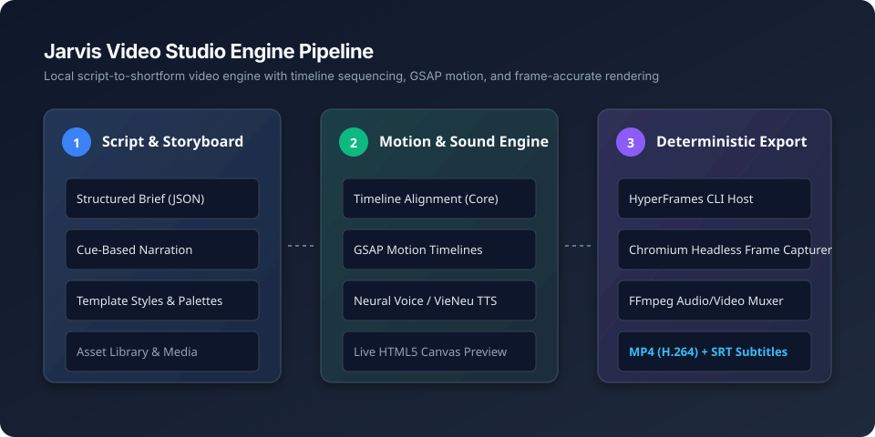

# Jarvis Video Studio

[](https://github.com/Sonness1304/jarvis-video-studio/actions/workflows/ci.yml)
[](LICENSE)
[](https://nodejs.org/)

**A code-driven short-form video creation studio and deterministic rendering engine.**  
Turn structured scripts, narration cues, and web motion graphics into polished vertical videos (9:16), animated explainers, and presentation shorts without paid cloud rendering farms.

---

## Architecture & Rendering Pipeline



1. **Script & Storyboard**: Author scenes, kinetic captions, data callouts, and layout presets in an interactive local workbench.
2. **Audio & Animation**: Speech timings align kinetic typography and GSAP motion timelines frame-accurately.
3. **Deterministic Rendering**: HyperFrames drives a headless browser to capture every animation frame, while FFmpeg handles audio normalization and multiplexing into crisp MP4 and SRT files.

---

## Key Features

- 🎬 **Timeline & Storyboard Editor**: Visual scene editor with drag-and-drop sequencing, live scrubbing, and frame-stepping preview.
- ⚡ **Code-Driven Motion Graphics**: Built on GSAP 3.15 and HTML5/SVG canvas for high-performance typographic animations, charts, and metrics.
- 🎙️ **Speech-First Synchronization**: Timelines compute cumulative frame offsets based on speech cues, preventing audio-video drift.
- 🗂️ **Storytelling Templates**: 11 ready-to-use narrative formats (Explain an Idea, Short Story, Knowledge Map, Data Story, Comparison, Showcase).
- 🎨 **Theme Engine**: 12 curated visual palettes (Editorial, Bold Pop, Dark Cinema, Paper Story, Blueprint, etc.) with custom accent colors.
- 🔒 **Zero Cloud Lock-In**: Runs 100% locally on your machine. Your scripts, media, and voice assets remain private.

---

## Quickstart

### 1. Prerequisites
- **Node.js**: v22.0.0 or higher
- **FFmpeg**: Optional for web preview; required for final MP4 video export.

### 2. Installation
```bash
git clone https://github.com/Sonness1304/jarvis-video-studio.git
cd jarvis-video-studio
npm install
```

### 3. Setup & Auto-Detection
Run the automated environment detector:
```bash
npm run setup
```
This inspects your machine for FFmpeg, Python, and Chrome, creating `runtime-config.json` automatically.

### 4. Start the Studio
```bash
npm start
```
Open **`http://127.0.0.1:20130`** in your browser to launch the studio workbench.

---

## Project Structure

```text
jarvis-video-studio/
├── briefs/                 # Sample video briefs (e.g. demo-explainer.json)
├── desktop/                # Optional native Windows desktop application wrapper (C# / WebView2)
├── docs/                   # Guides, diagrams, and architecture assets
├── scripts/                # Setup and batch automation scripts
├── src/                    # Backend engine, server, timeline compiler, and CLI
│   ├── composition.mjs     # GSAP HTML/SVG composition builder
│   ├── core.mjs            # Timeline calculation, phrase cues, and audio cache keys
│   ├── editor-server.mjs   # Local studio web server and REST APIs
│   └── studio.mjs          # Template catalog and brief validator
├── web/                    # Frontend client (HTML, CSS, ES modules)
└── tests/                  # Automated test suite
```

---

## Testing

Run the automated test suite:
```bash
npm test
```
The test suite validates timeline calculations, cue alignments, subtitle generation, template validity, and server endpoints.

---

## License & Attribution

- **Project Code**: Licensed under the [MIT License](LICENSE) &copy; 2026 Sonness1304.
- **Third-Party Dependencies**: HyperFrames (Apache-2.0), Sharp (Apache-2.0), GSAP (GreenSock Standard License), VieNeu (Apache-2.0), and Be Vietnam Pro (SIL OFL-1.1). See [THIRD-PARTY.md](THIRD-PARTY.md) for full license notices.